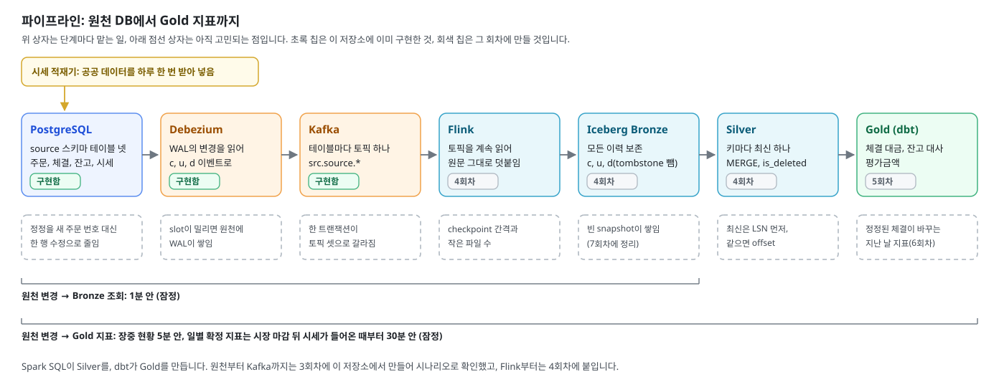

# CDC, Iceberg, dbt 실시간 레이크하우스

가상의 모바일 증권 앱에서 **주문이 정정되거나 취소되고 체결이 철회돼도, 잔고와 손익(환율 포함)이 원천과 원 단위까지 맞는지**를 측정과 검증으로 보이는 개인 프로젝트입니다.

PostgreSQL의 변경을 Debezium과 Kafka로 받아 Flink로 Apache Iceberg에 쌓고, Spark SQL과 dbt로 분석 마트를 만들고, Airflow로 주기 실행합니다.
그 위에 숫자를 지어내지 않고 근거로 설명하는 AI 기능([AI 트랙](docs/ai/README.md))을 얹습니다.

> 상태(2026-11-12): 원천부터 Bronze, Silver, Gold, 증분 갱신, Iceberg 유지보수, Airflow 주기 실행까지 이 저장소에서 돌려 확인했습니다. AI 트랙은 E01(손익), E04(묻고 답하기), E03(비슷했던 때)을 평가 기준대로 돌렸고, 통과하지 못한 것도 그대로 적었습니다. 계획과 진행 기록은 [docs/PLAN.md](docs/PLAN.md)에 있습니다.



## 지금까지 확인한 것

### 파이프라인

| 확인 | 결과 | 조건과 근거 |
|---|---|---|
| 원천 시나리오 여섯 단계(주문, 정정, 부분 체결, 취소, 매도, 전량 체결)의 변경 이벤트가 빠짐없이 도착하나 | Kafka 토픽에 주문 6, 체결 2, 잔고 3개. Bronze에는 tombstone을 뺀 6, 2, 2행 | [설계 5절](docs/design/source-tables.md), [첫 실행 보고서 1절](docs/reports/2026-11-12_lake-bronze-silver-gold.md) |
| Flink 작업을 멈췄다 다시 켜도 중복, 누락이 없나 | savepoint에서, Kafka에 남은 읽은 위치에서, 카탈로그 DB 장애 뒤 자동 복구, 세 경우 모두 행 수 그대로, 같은 전달 위치 중복 0 | 첫 실행 보고서 1절 |
| Silver가 키마다 현재 상태 하나를 만드나 | 잔고는 전량 매도 뒤 저장된 행 1개(`is_deleted = true`, 수량과 평단 NULL), 유효한 행 0개. 주문 1001은 `CANCELLED`, 체결 수량 4 | [0010](docs/decisions/0010-silver-current-state-rules.md), 첫 실행 보고서 2절 |
| 같은 입력이나 과거 변경을 다시 넣으면 | 모든 Silver 테이블에서 바뀐 행 0. 버전 가드를 뺀 대조 시험에서는 판 잔고가 되살아남 | 첫 실행 보고서 2절 |
| Gold와 데이터 테스트 | `dbt build` 55개 모두 통과(시세, 환율 포함) | 첫 실행 보고서 3, 5절 |
| 실제 시세를 원천에 넣었을 때 | 시세 4,736행, 환율 245행. Silver가 원천과 종목별 행 수, 기간, 종가 합, 거래량 합까지 같음 | 첫 실행 보고서 5절 |
| 화면이 레이크하우스의 Gold를 읽나 | 2년치 시세 9,472행과 환율 488일이 원천 → Bronze → Silver → Gold 마트(`mart_symbol_daily`, `mart_fx_daily`)를 거쳐 원천, 받은 원본과 한 행씩 같고, 화면 파일은 이 마트에서 내보냄. `dbt build` 70개 통과(새 마트와 데이터 테스트 포함) | [F 설계서 7절](docs/ai/F-screen.md) 「화면이 Gold 마트를 읽게」 |
| 화면에 넣은 내 매매도 레이크를 거치나 | 저장 매매를 원천 주문, 체결, 잔고로 옮겨(계좌 `A-SCREEN`) CDC → Bronze → Silver → Gold `fct_execution`까지. 시험 매매 4종목 10줄에서 체결 9건이 모두 같고, Gold 체결로 다시 센 손익이 화면 손익과 4/4종목 같음. 줄을 지우면 Silver에 지움 표시로 반영 | [F 설계서 7절](docs/ai/F-screen.md) 「내 매매도 CDC로」 |
| 검증한 손익 SQL이 레이크(Spark)에서도 같나 | 장부만 `aggregate` 접기로 바꾼 Spark 판이 골든 30/30, 입력 순서 섞기 150/150. Gold 손익 마트(`pnl_position`)가 화면 손익과 시험 매매 4/4종목 칸마다 같음 | [손익 SQL 설명서](sql/pnl/README.md), [F 설계서 7절](docs/ai/F-screen.md) 「Spark 손익 마트」 |
| 시세를 다시 받아 넣을 때 가짜 변경 이벤트가 생기나 | PostgreSQL에서 두 번째 적재의 고친 행 0, 토픽 끝 위치 그대로 | [데이터 준비 2절](docs/ai/data-prep.md), [0006](docs/decisions/0006-batch-prices-through-cdc.md) |
| 바뀐 것만 다시 계산해도 전체 재계산과 같은가 | 일별 종목별 체결 대금에서 여섯 경우 모두 `증분에만 0 / 정답지에만 0`. 날짜를 정정하면 옛 거래일 행이 지워짐. 중간에 멈추고 다시 돌려도 0 / 0 | [증분, 유지보수, Airflow 보고서 1절](docs/reports/2026-11-12_incremental-maintenance-airflow.md) |
| Iceberg 유지보수가 값을 바꾸지 않나 | 압축, 스냅샷 만료, 고아 파일 정리, manifest 합치기 뒤 행 수와 합계 그대로. 스냅샷 10 → 3, 데이터 파일 10 → 2 | 같은 보고서 2절 |
| 주기 실행과 재시도 | Airflow DAG(Silver → dbt → 증분 Gold, 30분마다) 정기 실행과 수동 실행 성공. Spark를 멈춰 실패시킨 실행은 1분 뒤 재시도로 성공 | 같은 보고서 3절 |
| 레이크 쪽 일을 사람이 돌리나 | 같은 DAG에 화면 매매 옮기기, Bronze 기다리기(센서), 화면 파일 내보내기, 화면 매매 대조를 붙여 태스크 일곱 개. 정기 실행은 한 번 약 2분 20초. Bronze를 멈춘 채 시험 매매를 넣으면 센서가 기다리다 Bronze를 다시 켜자 끝까지 성공(체결 9/9, 손익 마트 4/4종목 같음) | [화면 설계서](docs/ai/F-screen.md) 7절 「Airflow로 묶기」 |
| 규모를 키우면 어디서 막히나 | 합성 매매 26만 건(꾸준히 초당 20건, 몰아서 1만, 5만, 20만). 원천 커밋 → Bronze는 p95 약 10초(checkpoint 간격이 정함), 20만 건도 17.9초 안에 모두 보임. 먼저 막힌 곳은 원천의 지우기(체결 `order_id` 인덱스 없음, 5만 건 36.6초 → 인덱스 두면 0.62초)와 Silver MERGE가 Bronze 이력 전체를 읽는 것. 모두 지운 뒤 Gold 지문 5/5 그대로 | [규모 시험 보고서](docs/reports/2026-11-18_scale-test.md) |

### AI 트랙

| 확인 | 결과 | 조건과 근거 |
|---|---|---|
| 나눠 사고판 매매의 원화 손익(평균 단가, 실현과 평가, 환율 효과 나누기, 연 환산, 최대 낙폭) | 골든 사례 30개의 정답 칸이 모두 일치(원은 원 단위, 달러는 센트). dbt 모델로 돌린 본 실행도 30/30 | DuckDB, 가짜 시세. [`sql/pnl/`](sql/pnl/README.md), [E01 5절](docs/ai/experiments/E01-pnl.md) |
| 흔한 어림(달러 손익 x 기준일 환율)은 얼마나 틀리나 | 미국 사례 21개 가운데 1개만 맞음. 평균 오차는 평균 손익의 8.9%(가짜 시세에서 나온 값이라 실제 시장의 오차 크기는 아님) | 같은 가짜 시세. E01 5절 |
| 묻고 답하는 에이전트가 숫자를 지어내지 않나 | 고정 경로(H1)로 숫자 정답이 개발용 1/28에서 28/28로. 확인용 24개에서 숫자 18/18, 틀린 숫자 0. 다만 모름과 되묻기 2/4, 금지 표현 2건으로 **통과 못 함** | 가짜 세계, 질문 60개. [E04 5절](docs/ai/experiments/E04-agent.md) |
| 비슷했던 때로 앞날의 범위를 말할 수 있나 | 변동성은 확인 구간에서 기준선 셋을 모두 이김. 범위(pinball loss)는 「최근」, 「섞음」 기준선을 못 이겨 **통과 못 함**. 그래서 전망 범위는 기준선으로 냄 | 코스피 일별, 1995년부터. [E03 5절](docs/ai/experiments/E03-regime.md) |

## 앞으로 확인할 것

| 질문 | 어떻게 보이나 |
|---|---|
| 스트리밍 처리가 유입 속도를 따라가는가 | 변경을 늘려 넣으며 원천 → Bronze → 마트 구간별 지연 재기 |
| 체결, 주문, 잔고가 같은 원천 commit까지 반영됐는지 맞출 수 있나 | Debezium `source`의 트랜잭션 번호로 세 테이블 묶기 |
| 체결 직후 작업 노드가 멈춰도 결과가 맞나 | [가이드 08](docs/guide/08-airflow-and-recovery.md) 9-3의 복구 시나리오 |
| 뉴스와 일정으로 근거를 대는가(E02) | 일정 데이터 출처를 정한 뒤 평가 기준부터 커밋 |

숫자는 측정 조건(기기, VM 자원, 버전, 데이터 규모)과 함께 [docs/reports/](docs/reports/README.md)에 남깁니다.

## API 키 없이 해 보기

시세는 재배포할 수 없어 저장소에 없습니다. 아래는 가짜 시세로 돌아가므로 API 키도 Docker도 필요 없습니다.

```bash
make setup    # .venv와 패키지
make check    # 손익 골든 30개, 공개 전 검사
```

## 전체 실행

준비물은 Docker 엔진입니다. 이 저장소는 Colima VM(CPU 6, 메모리 12GB)으로 확인했습니다. 기본 구성은 약 2GB, Airflow까지 모두 띄우면 컨테이너 메모리 합이 약 5.7GB입니다.

**1. 기본 구성(원천과 CDC)**

```bash
cp .env.example .env       # 비밀번호를 바꿈
docker compose up -d       # PostgreSQL, Kafka, Connect, Kafka UI
infra/connect/register.sh  # 커넥터 등록
```

원천 테이블은 처음 띄울 때 `infra/postgres/init/`에서 만들어집니다. 볼륨이 이미 있으면 [데이터 준비 10절](docs/ai/data-prep.md)의 명령으로 시세, 환율 테이블을 만듭니다. 변경 시나리오는 [`infra/postgres/scenario/`](infra/postgres/scenario/README.md)의 파일을 차례로 돌립니다(가이드 03의 11-9). 시세와 환율 적재기는 [`loaders/`](loaders/README.md)에 있고, 키는 각자 발급합니다([`data/README.md`](data/README.md)).

**2. 레이크(Bronze, Silver, Gold)**

```bash
docker compose --profile flink --profile spark up -d
infra/flink/submit-bronze.sh          # Kafka → Bronze
infra/spark/silver.sh                 # Bronze → Silver MERGE
infra/spark/check-silver.sh           # 기대값, 다시 넣기 검증
docker compose --profile spark run --rm dbt build
```

켜졌는지는 한 줄 조회로 봅니다. 시나리오 여섯 단계 뒤라면 Bronze 주문은 6행, Silver 유효 잔고는 0행입니다.

```bash
infra/spark/sql.sh -e "SELECT count(*) FROM lake.bronze.orders"
infra/spark/sql.sh -e "SELECT count(*) FROM lake.silver.holdings WHERE NOT is_deleted"
```

**3. 증분 Gold와 주기 실행(선택)**

```bash
docker compose --profile spark run --rm \
  --entrypoint python dbt \
  /workspace/sql/gold_incremental/run.py --compare
docker compose --profile spark --profile airflow up -d
docker compose exec airflow \
  airflow dags unpause lakehouse_refresh
```

DAG는 멈춘 상태로 만들어집니다. 화면의 사용자는 `admin`이고, 비밀번호는 컨테이너가 처음 뜰 때 컨테이너 안의 파일(`/opt/airflow/standalone_admin_password.txt`)에 만들어집니다. 저장소나 채팅에 옮기지 않습니다.

| 서비스 | 주소 |
|---|---|
| Kafka UI | http://localhost:18080 |
| Flink | http://localhost:18081 |
| Airflow | http://localhost:18082 |
| Kafka Connect REST | http://localhost:18083 |
| Spark UI | http://localhost:14040 |
| S3 호환 저장소 콘솔 | http://localhost:19001 |
| Spark Thrift server | `localhost:10000` |
| PostgreSQL | `localhost:5432` |
| Kafka(호스트에서) | `localhost:29092` |

**끄기**

```bash
docker compose exec airflow \
  airflow dags pause lakehouse_refresh
infra/flink/stop-bronze.sh   # savepoint를 남기고 멈춤
docker compose --profile flink --profile spark \
  --profile airflow stop
```

`stop-bronze.sh`가 찍은 savepoint 경로를 다음에 `infra/flink/submit-bronze.sh <경로>`로 주면 그 자리에서 이어서 읽습니다. 볼륨은 남아 다음에 이어집니다. `docker compose down -v`는 원천, 카탈로그, 레이크 데이터까지 모두 지우니 처음부터 다시 만들 때만 씁니다.

macOS에서 Colima를 쓸 때:

```bash
brew install colima docker docker-compose
colima start --cpu 6 --memory 12 --disk 60
colima stop                # 다 쓴 뒤
```

## 문서 길잡이

| 읽을 것 | 어디 |
|---|---|
| 설계: 업무 질문, 원천 테이블, 층마다 맡는 일 | [docs/design/](docs/design/README.md) |
| 결정 기록: 왜 이렇게 정했나 | [docs/decisions/](docs/decisions/README.md) |
| 실패와 고친 것 | [docs/failures.md](docs/failures.md) |
| 측정 보고서 | [docs/reports/](docs/reports/README.md) |
| AI 트랙: 문제, 가설, 평가 기준, 결과 | [docs/ai/](docs/ai/README.md) |
| 계획과 진행 기록 | [docs/PLAN.md](docs/PLAN.md) |
| 학습 노트: 회차별 입문 가이드 00 ~ 08 | [docs/guide/](docs/guide/00-overview.md) |

## 작업 방식

- **평가 기준을 먼저 고정합니다.** AI 기능은 지표, 평가셋, 통과선을 개발 전에 커밋하고, git 기록의 날짜로 순서를 남깁니다([0009](docs/decisions/0009-commit-evaluation-before-development.md)). E03은 커밋 대신 sha256 기록으로 고정했고, 그 사실과 순서를 E03 문서에 밝혔습니다.
- **통과 못 한 결과도 그대로 적습니다.** 확인용 결과를 보고 나서 기준이나 답을 고치지 않습니다.
- **숫자는 코드로, 판단만 모델로.** 손익과 지표는 결정적 SQL이 계산하고, 언어 모델은 그 결과를 도구로 불러 설명만 합니다.
- **관계는 상관까지만.** 데이터 사이의 관계는 "같이 움직였다"까지만 말하고, 투자 권유를 하지 않습니다.
- **Claude Code와 함께 만듭니다.** 코드와 문서 초안은 Claude Code와 함께 썼습니다. 결정과 평가 기준은 사람이 정합니다. 사람 검산은 아직 일부(E01의 사례 하나, E04의 질문 문구)이고, 결과는 따로 만든 계산기, 골든 사례, 실습 값으로 확인합니다.
- **데이터는 약관대로.** 받은 원본은 `data/raw/`(git 제외)에만 두고, 저장소에는 받는 코드와 집계만 둡니다.

## 폴더

```text
.
├── docker-compose.yml   로컬 실행 구성(profile: 기본, lake, flink, spark, dbt, airflow)
├── Makefile             API 키 없는 확인
├── infra/
│   ├── postgres/init/   스키마, 원천 테이블
│   ├── postgres/scenario/  변경 시나리오
│   ├── connect/         Connect와 커넥터
│   ├── flink/           Bronze 적재 작업
│   ├── spark/           Silver 실행과 검증
│   ├── dbt/             dbt 이미지
│   └── airflow/         Airflow 이미지
├── sql/
│   ├── silver/          Silver MERGE와 검증 SQL
│   ├── gold_incremental/  증분 Gold
│   ├── maintenance/     Iceberg 유지보수
│   └── pnl/             손익 SQL
├── dbt/                 Silver core와 Gold 모델, 테스트
├── airflow/dags/        주기 실행 DAG
├── loaders/             시세, 환율, 뉴스 적재기
├── ai/                  AI 기능(도구, 에이전트, 프롬프트)
├── eval/                평가셋과 정답
├── scripts/             공개 전 검사
├── data/                출처와 약관
└── docs/
    ├── design/          설계
    ├── decisions/       결정 기록
    ├── failures.md      실패와 고친 것
    ├── reports/         측정 보고서
    ├── ai/              AI 트랙
    ├── guide/           회차별 입문 가이드
    └── PLAN.md          계획과 진행 기록
```

## 버전

자세한 조합과 고른 이유는 [0002](docs/decisions/0002-lake-versions.md)에 있습니다.

| 구성 | 버전 |
|---|---|
| PostgreSQL | `postgres:16.15`(원천, 카탈로그 각각) |
| Kafka (KRaft) | `apache/kafka:4.3.2` |
| Kafka Connect + Debezium | `apache/kafka:4.3.2`에 Debezium PostgreSQL 커넥터 `3.6.3.Final`을 넣어 빌드 |
| Kafka UI | `kafbat/kafka-ui:v1.5.0` |
| Flink | `flink:1.20.4`, Kafka 커넥터 3.4.0-1.20 |
| Iceberg | 1.10.0(Flink, Spark 런타임), JDBC 카탈로그 |
| Spark | `apache/spark:3.5.6` |
| S3 호환 저장소 | `pgsty/silo`(MinIO 포크, digest 고정) |
| dbt | `dbt-core` 1.12.5, `dbt-spark` 1.9.3 |
| Airflow | `apache/airflow:2.10.5-python3.11` |

이미지는 Docker Hub에서, jar는 Maven Central에서(sha256 대조), 파이썬 패키지는 PyPI에서 받습니다. Connect, Flink, Spark, dbt, Airflow 이미지는 처음 띄울 때 빌드합니다.

## 참고

- 메타코드M 「실시간 데이터 수집부터 분석 마트까지 — CDC, Iceberg, dbt」 스터디 커리큘럼을 바탕으로 혼자 진행합니다. 입문 가이드는 강의를 듣고 제 말로 다시 쓴 학습 노트이고, 강의 원문과 자료는 저장소에 넣지 않습니다.
- [Debezium PostgreSQL Connector](https://debezium.io/documentation/reference/stable/connectors/postgresql.html)
- [Apache Iceberg](https://iceberg.apache.org/docs/latest/)
- [Iceberg Flink Writes](https://iceberg.apache.org/docs/latest/flink-writes/)
- [dbt 소개](https://docs.getdbt.com/docs/introduction)
- [Apache Airflow](https://airflow.apache.org/docs/)
