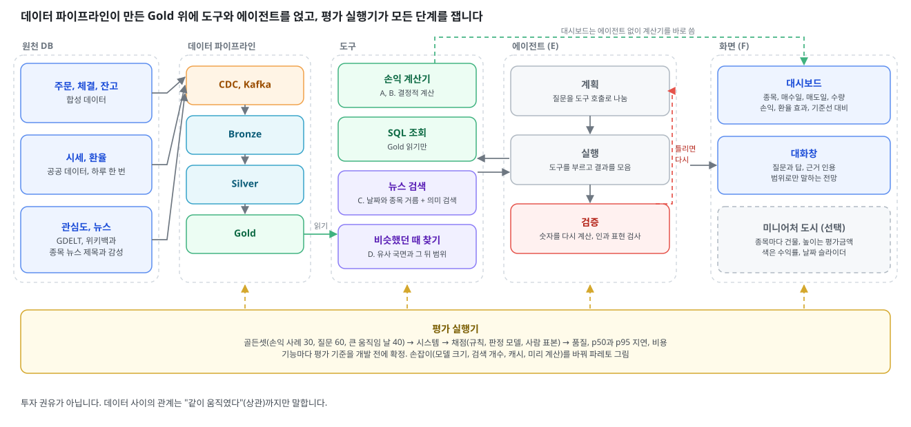

# AI 트랙: 포트폴리오 타임머신 (가제)

이 저장소의 데이터 파이프라인(원천 DB → CDC → Bronze → Silver → Gold) 위에 **사용자에게 닿는 AI 기능**을 얹는 계획입니다.
목표는 기능 자체보다, 기능마다 **문제 정의 → 가설 → 평가 기준 → 개발 → 실패와 개선**의 사이클을 기록으로 남기는 것입니다.

> 투자 권유가 아닙니다. 매수나 매도를 추천하는 기능은 만들지 않습니다. 전망은 범위로만 보여 주고, 그 범위가 과거에 얼마나 맞았는지를 함께 보여 줍니다.
> 데이터 사이의 관계는 "같이 움직였다"(상관)까지만 말하고 "그래서 움직였다"(인과)라고 하지 않습니다.

## 1. 만들 것

사용자(가상의 증권 앱 고객)가 종목을 고르고 나눠서 사고판 매매(날짜, 수량, 체결가)를 넣으면 아래를 봅니다. 매매 한 건은 원천 테이블 `executions`의 한 행입니다.

| 기능 | 보여 주는 것 | 방식 |
|---|---|---|
| A. 손익 | 평균 단가, 실현 손익과 평가 손익, 원화와 달러, 환율 반영 | 결정적 계산(dbt Gold) |
| B. 기간 상태 | 누적 손익, 최대 낙폭, 변동성, 연 환산 수익률(내부수익률), 기준선(SPY) 대비, **원화 수익을 가격 효과와 환율 효과로 나누기** | 결정적 계산(dbt Gold) |
| C. 그때 무슨 일이 | 보유 기간의 큰 움직임과 같은 날의 뉴스, 관심도, 일정(금리 결정, 물가 지표) | RAG(근거를 인용) |
| D. 비슷했던 때 | 지금과 비슷했던 과거 국면들과, 그 뒤 N일에 실제로 나온 범위 | 유사 국면 검색과 백테스트 |
| E. 묻고 답하기 | "작년 3월에 QQQ를 10주 샀다면?" 같은 질문에 A ~ D를 도구로 불러 답 | 에이전트(계획, 도구, 검증) |
| F. 화면 | 대시보드와 대화창. 선택: 포트폴리오 미니어처 도시(종목마다 건물, 높이는 평가금액, 색은 수익률, 날짜 슬라이더) | 웹 앱 |
| G. 주간 노트(선택) | 한 주의 시장과 내 포트폴리오를 근거 인용과 함께 정리한 글 | 생성과 검증 |

처음 요청(종목, 매수와 매도 시점, 수량, 환율, 수익, 기간 상태, 전망)에 더해 넣은 것:

- **나눠서 사고팔기(A):** 현실의 투자자는 한 번에 사고팔지 않습니다. 평균 단가(이동평균법), 실현과 평가 손익을 매매 한 건씩 계산합니다. 체결가와 그 매매의 환율을 넣을 수 있고, 비우면 그날 종가와 기준율을 씁니다. 체결가가 그날 가격 범위를 벗어나면 알려 줍니다.
- **환율 효과 나누기(B):** 미국 ETF의 원화 수익은 "가격이 올라서"와 "달러가 올라서"가 섞여 있습니다. 둘을 나눠 보여 주면 해외 투자에서 가장 헷갈리는 부분이 풀립니다.
- **기준선 대비(B):** "같은 날 같은 돈을 SPY에 넣었다면"과 나란히 보여 줍니다. 수익이 좋았는지는 비교 대상이 있어야 판단할 수 있습니다.
- **전망을 범위로(D):** "오를 것이다" 대신 "비슷했던 12번 가운데 9번은 이 범위 안"처럼 빈도로 말하고, 그 말이 과거에 얼마나 맞았는지(적중률)를 같이 보여 줍니다.

## 2. 기르려는 역량과 보여 줄 곳

| 역량 | 이 프로젝트에서 보여 줄 곳 |
|---|---|
| 문제 정의부터 정량 평가까지 전 과정 | 기능마다 실험 기록(`experiments/`)의 다섯 칸 |
| 품질, 지연, 비용의 트레이드오프와 최적화 | 같은 평가셋으로 손잡이(모델 크기, 검색 개수, 캐시, 미리 계산)를 바꿔 잰 표와 파레토 그림 |
| 사용자에게 닿는 전체 시스템 | 원천 DB의 주문부터 화면의 답까지 한 번에 도는 데모 |
| 프롬프트, RAG, 에이전트 워크플로 | C(RAG), E(에이전트). 프롬프트는 판 번호가 있는 파일로 관리 |
| 평가 기준을 먼저 세우고 품질을 지표로 정의 | 기능마다 평가 기준을 **개발 전에 커밋**합니다. git 기록의 날짜가 순서를 증명합니다 |
| 모호한 환경에서 길 찾기 | 미리 예상한 실패와 실제 실패, 가설이 틀렸을 때 무엇을 바꿨는지의 결정 기록 |

## 3. 사이클의 틀

모든 실험은 [`experiments/TEMPLATE.md`](experiments/TEMPLATE.md)의 다섯 칸을 씁니다. 실험은 [E01 손익](experiments/E01-pnl.md), [E02 RAG](experiments/E02-rag.md), [E03 유사 국면](experiments/E03-regime.md), [E04 에이전트](experiments/E04-agent.md)입니다.

| 칸 | 적을 것 |
|---|---|
| 문제 | 누가 무엇을 못 해서 곤란한가 |
| 가설 | "X를 하면 Y가 기준선보다 Z만큼 나아진다" |
| 평가 기준 | 지표, 평가셋, 통과선. **개발 전에 확정**하고, 바꾸면 날짜와 이유를 남김 |
| 개발 | 무엇을 만들었나, 판 번호 |
| 결과와 다음 | 통과 여부, 실패 사례, 다음 가설 |

## 4. 기능별 문제, 가설, 평가 기준

### A, B. 손익과 기간 상태 (결정적 계산)

자세한 계산 규칙, 골든 사례 30개, 기준선 값은 [E01](experiments/E01-pnl.md)에 있습니다.

| 칸 | 내용 |
|---|---|
| 문제 | 나눠 사고팔면 평균 단가와 환율이 얽혀, 실제 손익과 그 출처를 알기 어렵다 |
| 가설 | 이동평균법 dbt Gold 모델로 계산하면 손계산과 원 단위까지 같다 |
| 평가 기준 | 손으로 계산한 골든 사례 30개와 **정확히 일치**(원은 정수, 달러는 소수 둘째 자리). 실현 + 평가 = 총손익, 가격 효과 + 환율 효과 + 교차 효과 = 총손익(항등식 테스트). dbt 테스트로 자동 실행 |
| 기준선 | 스프레드시트 손계산, market-watch의 포지션 계산 |
| 미리 예상하는 실패 | 휴장일이라 종가가 없음, 미국 거래일과 환율 기준일이 어긋남, 시각대 경계, 보유보다 많이 판 입력, 체결가가 그날 범위 밖 |

골든 사례에 꼭 넣을 것: 국내 종목, 미국 ETF, 휴장일에 걸친 기간, 같은 날 사고팔기, 나눠 사기, 나눠 팔기, 일부 매도 뒤 추가 매수, 전량 매도 뒤 재매수, 체결가를 직접 넣은 매매, 환율만 움직인 기간.

나눠 사고팔면 돈이 들어간 때가 달라 단순 수익률(총손익 ÷ 매수 합계)이 왜곡되므로 연 환산 수익률(내부수익률)을 함께 냅니다. 세금 계산 방식은 범위 밖입니다.

### C. 그때 무슨 일이 (RAG)

자세한 범위, 0단계 조사, 인과 표현 규칙, 평가셋은 [E02](experiments/E02-rag.md)에 있습니다.

| 칸 | 내용 |
|---|---|
| 문제 | 큰 움직임이 있던 날 "무슨 일이 있었나"를 찾으려면 여러 곳을 뒤져야 한다 |
| 가설 | ETF 표시 기사는 하루 중앙값 0건이라(0단계) 창의 전체 기사에서 자산군 주제로 찾는다. 낱말 검색이 기준선보다, 의미 검색이 낱말 검색보다 관련 기사를 더 찾는다 |
| 평가 기준 | 큰 움직임 날 24개, 평범한 날 8개, 근거를 뺀 날 8개. 관련 표시는 판정 모델이 먼저 하고 사람은 표본만. recall@5, 근거 충실도(답의 문장 가운데 인용한 기사로 뒷받침되는 비율, 목표 95% 이상), **인과 표현 0건**, p95 지연, 질문당 비용 |
| 기준선 | 그날 기사를 최신순으로 5개 |
| 미리 예상하는 실패 | 주제어가 회사 이름과 보도자료에 걸림, 의견 글뿐이라 그날의 사건이 없음, 영어 기사에 한국어 질문, 답에 "때문에"가 섞임 |

### D. 비슷했던 때 (유사 국면)

자세한 범위, 판별력 시험, 미래 정보 막기, 결과에 따른 화면은 [E03](experiments/E03-regime.md)에 있습니다.

| 칸 | 내용 |
|---|---|
| 문제 | "이때는 이랬고 저때는 저랬으니 이럴 것이다"를 근거 없이 말하면 그럴듯한 이야기일 뿐이다 |
| 가설 | 최근 수익률과 변동성이 비슷한 과거 국면의 "이후 h일" 결과가, 단순한 기준선 셋보다 앞으로의 변동성과 범위를 더 잘 맞힌다. 합성 세계 시험으로는 실패할 가능성이 크다 |
| 평가 기준 | 코스피 일별 지수(1995년부터)로 판정. 앞쪽 60%로 개발하고 뒤쪽 40%를 한 번만 확인. 겹치지 않는 창으로 변동성 오차와 pinball loss를 재서 기준선 셋을 모두 이겨야 함. 80% 범위 적중률은 20일 70 ~ 90%, 5일 75 ~ 85%. 미래 바꾸기 시험 전부 통과. 미국 ETF는 참고만 |
| 기준선 | 과거 전체 분포, 최근 20일 변동성, 둘을 섞은 변동성 |
| 미리 예상하는 실패 | 방향은 "늘 오른다"를 못 이김, 비슷한 때 찾기가 섞은 기준선을 못 이김, 겹친 표본 때문에 범위가 좁음. 실패하면 전망은 기준선으로 내고 비슷했던 때는 사례로만 보입니다. 이 전환도 기록할 결과입니다 |

결과 문장은 "비슷했던 k번 가운데 m번은"처럼 빈도로만 쓰고, k는 겹치지 않는 때로 셉니다.

### E. 묻고 답하기 (에이전트)

자세한 범위, 도구, 날짜 해석 규칙, 금지 표현, 질문 60개의 구성은 [E04](experiments/E04-agent.md)에 있고, 질문과 정답은 [`eval/e04_agent/`](../../eval/e04_agent/)에 있습니다.

| 칸 | 내용 |
|---|---|
| 문제 | 질문은 말로 오는데, 답은 여러 도구(계산, 검색, 전망)를 엮어야 나온다. 모델이 직접 계산하면 그럴듯하게 틀린다 |
| 가설 | 고정 경로(모델은 분류만) → 에이전트 루프 → 검증 단계 → 작은 모델 순서로 더해 보고, 값을 못 하는 단계는 버린다 |
| 평가 기준 | 가짜 세계의 질문 60개(개발 36, 확인 24). 숫자 정답률 90% 이상, 틀린 숫자 0건, 답한 비율 90% 이상, 숫자 추적 100%, 거절과 모름 전부, 금지 표현 0건, 주입 문장 2건 모두, 지연과 비용(잠정) |
| 기준선 | 단발 프롬프트(도구 없이 데이터 요약만 넣고 답하게 함) |
| 미리 예상하는 실패 | "작년 이맘때" 같은 날짜 해석, 모델이 계산을 직접 해서 틀림, "금리 결정 때문이지?"에 맞장구침, 기사에 숨긴 지시를 따름 |

## 5. 품질, 지연, 비용 재기

- **평가 실행기 하나:** 골든셋 → 시스템 → 채점 → 결과 표(품질, p50과 p95 지연, 토큰, 비용) → 이전 실행과 비교.
- **바꿔 볼 손잡이:** 모델 크기(작은, 중간, 큰), 검색 개수 k, 프롬프트 캐시, Gold에 미리 계산 대 질문 때 계산, 쉬운 질문은 작은 모델로 보내기(라우팅).
- **결과 그림:** 품질 대 비용, 품질 대 p95 지연의 파레토 그림.
- **모델 호출:** `claude -p`로 부릅니다. 비용은 호출 결과의 값을 기록하고, 지연은 빈 호출로 CLI 기동 시간을 재서 뺍니다. 호출 코드는 한 곳에 모아, 공개할 때 API 키로 바꿀 수 있게 둡니다.
- **채점:** 숫자는 규칙으로 정확히. 글은 판정 모델로 채점하고, 사람이 표본을 다시 봐서 **판정 모델과 사람의 일치율**도 잽니다.

## 6. 데이터

| 데이터 | 쓰는 기능 | 출처 |
|---|---|---|
| 일별 시세 | A, B, C, D | `source.daily_prices`(공공데이터포털, Massive) |
| 코스피 일별 지수 | D의 판정 | 한국은행 ECOS(무료 키). 출처 표시 필요, 값은 저장소에 두지 않음 |
| 원/달러 환율 | A, B, D | 한국은행 ECOS(무료 키) 일별 환율을 `source.fx_rates`로(예정) |
| 주문, 체결, 잔고 | A, B, E | 합성 데이터 |
| 관심도 | C, D | `source.attention_daily`(GDELT, 위키백과 조회수 등) |
| 뉴스 제목과 요약 | C | Massive 뉴스(본문은 받지 않음). 종목 표시와 창의 전체 기사. 국내 종목은 공식 무료 출처를 찾으면 다음 판 |
| 일정(금리 결정, 물가 지표, 실적) | C, D | 정할 것 |

출처와 약관은 [`../../data/README.md`](../../data/README.md)에 있습니다.

## 7. 일정 (강의와 나란히)

| 기간 | 강의 | 할 일 | 산출물 |
|---|---|---|---|
| 11/06 ~ 11/29 | 1 ~ 3회차 | 문제 정의, 가설, 평가 기준 확정. 골든셋 초안(손익 사례 30, 질문 60). 11/06에 네 실험의 초안을 씀. E02, E03의 0단계 조사와 커밋이 남음 | 이 문서, `experiments/E01 ~ E04`의 1 ~ 3칸 |
| 11/30 ~ 12/18 | 쉼 | 쉼 | |
| 12/19 ~ 12/27 | 4회차 | 평가 실행기, 손익 계산기와 골든 사례 | 골든 사례 통과 |
| 12/28 ~ 01/03 | 5회차 | 손익을 dbt Gold 모델과 테스트로(5회차 dbt와 겹침), 환율 적재 | E01 결과 |
| 01/04 ~ 01/10 | 6회차 | C(RAG). 0단계 조사는 그 전에 | E02 결과 |
| 01/11 ~ 01/17 | 7회차 | E(에이전트)와 트레이드오프 실험 | E04 결과, 파레토 그림 |
| 01/18 ~ 01/24 | 8회차 | F(화면)와 전체 데모 | 데모 |
| 01/25 ~ 01/31 | 마무리 | D(유사 국면) 백테스트, 발표 | E03 결과 |

강의와 겹쳐 빠듯합니다. 시간이 모자라면 미니어처 도시, 관심도 확장, D의 범위 순서로 줄입니다. D는 변동성 범위 하나만 남겨도 사이클은 완성됩니다.

## 8. 다시 쓸 것

이전에 만든 두 작업에서 틀을 가져옵니다. 코드를 통째로 옮기지 않고, 필요한 부분을 이 저장소에 맞게 다시 씁니다.

| 가져올 것 | 출처 | 쓰는 곳 |
|---|---|---|
| 평가 실행기 틀: 골든셋과 정답 파일, 따로 떼어 둔 확인용 세트(holdout), 규칙을 뺀 판과 비교(ablation), 호출 상한, 호출당 비용 기록 | [market-watch](https://ejmogly.github.io/market-watch/) `eval/` | 평가 실행기(5절) |
| 검증 에이전트: 원출처를 다시 받아 숫자를 다시 계산하고 PASS, WARNING, ERROR, NEED MORE INFO로 판정. 대조할 수 없으면 추정하지 않고 멈춤 | market-watch 검증 담당 | E의 검증 단계 |
| 사고 기록 분류(종류, 심각도, 누가 먼저 찾았나, 재발했나)와 실행 장부 형식 | market-watch `metrics/` | 실패와 개선 기록. 토큰과 비용 칸은 새로 더함 |
| 프롬프트 조립, 배포한 프롬프트와 원본 대조, 도구 막기 가드레일 | market-watch `routines/` | 프롬프트 판 관리 |
| 보유 단가(이동평균)와 원화 환산 | market-watch 손익 화면 | A의 계산 대조 |
| 일정 출처: 연준 금리 결정, 물가와 고용 지표 발표일, 공시 | market-watch 이벤트 달력 규칙 | C의 근거, 상관 점검의 「공통 원인」 |
| 겹치지 않는 구간과 부트스트랩 90% 구간, 표본 밖 판단을 고치지 않고 쌓는 장부, 사건 뒤 반응 계산 | market-watch 분석 스크립트 | D의 백테스트 |
| 공개본을 만들 때의 가림과 금지어 검사 | market-watch 공개본 생성기 | 이 저장소를 공개할 때 |
| 에이전트 규칙의 표현: 문서는 지시가 아니라 데이터, 출처 없는 숫자 표시, 허용 도구 목록, 사람 검토 지점. 유료 데이터 연결은 쓰지 않음 | [anthropics/financial-services](https://github.com/anthropics/financial-services)(Apache-2.0)의 `market-researcher` | E04의 프롬프트 |
| 3D 화면: Three.js, 빌드 없는 ES 모듈, CC0 모형, 시간 슬라이더와 재생, 녹화 스크립트(Playwright, ffmpeg) | 이전 3D 미니어처 대시보드 | F의 미니어처 도시(새로 짬) |

market-watch에서 얻은 교훈 둘을 처음부터 규칙으로 둡니다.

- **규칙으로 잡을 수 있는 것은 코드로, 판단만 모델로.** market-watch에서는 기사 제목 대조를 프롬프트 규칙으로 끝내 잡지 못했습니다. 숫자 재계산, 날짜 확인, 인과 표현 검사는 스크립트가 하고, 모델은 문장과 판단만 맡깁니다.
- **출처는 공식 경로만.** market-watch는 비공식 시세 경로를 썼지만, 이 저장소는 공개할 것이라 약관이 분명한 출처(공공데이터포털, Massive, ECOS, GDELT)만 씁니다.

## 9. 정한 것

| 무엇을 | 정한 것 |
|---|---|
| 모델 호출 | `claude -p`. 호출 코드는 한 곳에 모아 나중에 API 키로 바꿀 수 있게 둠 |
| 일정 | 강의와 나란히 1월 말까지 |
| 화면 | 대시보드와 대화창이 있는 단순한 웹 앱. 미니어처 도시는 2D 그림 수준으로 두고 여유가 있으면 3D로 |
| 매매 입력 | 나눠서 사고팔기, 이동평균법. 체결가와 환율은 비우면 그날 종가와 기준율 |
| 공개 데모 | 끝난 뒤 정함. 그때까지 데모는 내 컴퓨터에서만. 시세는 재배포 금지 |
| E02 1판 종목 | 미국 ETF 12개와 개별 기업 5개(NVDA, AAPL, TSLA, GOOGL, TSM). 국내 2종목은 손익 계산과 시세에만 있고 뉴스 근거에서는 빠짐 |
| 환율 출처 | 한국은행 ECOS |
| E03 판정 데이터 | 코스피 일별 지수. 미국 ETF 2년은 답을 아는 방법도 판정 시험을 대부분 통과하지 못해 참고만 |
| E04 평가 세계 | 가짜 세계. 모델이 기억으로 답하지 못해 도구 사용이 드러나고 정답을 커밋할 수 있음 |

아직 정할 것: 일정 데이터(금리 결정, 물가 지표, 실적)의 출처, 실제 환전 환율을 체결마다 남길지.
