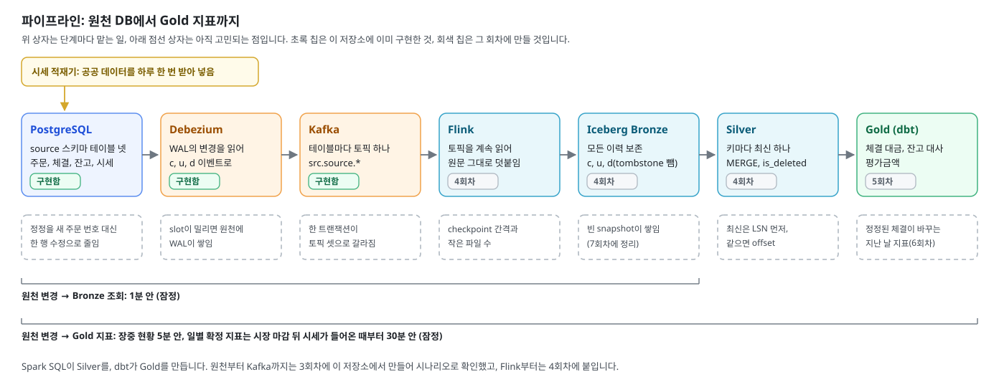

# 설계

가상의 모바일 증권 앱에서 주문, 체결, 잔고, 일별 시세가 원천 DB에서 바뀔 때, 그 변경이 Gold 지표까지 어떻게 가는지 정한 문서입니다.
3회차에 원천 설계를 확정했고, 4회차부터 층마다 채웁니다.

## 업무 질문

> **주문이 정정되거나 취소되고 체결이나 종가가 정정돼도, 일별 체결 대금과 계좌별 잔고, 평가금액과 손익이 원천과 맞는가?**

| 칸 | 내용 |
|---|---|
| 결과를 쓰는 사람 | 장중에는 운영 담당자가 종목별 미체결 잔량과 주문 취소율로 이상 주문을 알아챕니다. 장 마감 뒤에는 정산 담당자가 체결 대금과 계좌별 잔고를 원천과 대사하고 평가금액을 계산합니다. 고객은 앱에서 자기 손익과 「오늘의 시장」 카드를 봅니다 |
| 늦거나 틀리면 | 취소한 주문이 미체결로 남아 잔량이 부풉니다. 정정 전 가격으로 체결 대금을 셉니다. 전량 매도한 종목이 잔고에 남습니다. 정정된 종가를 놓치면 지난 평가금액이 틀린 채 남습니다 |

## 지연 목표 (잠정)

| 범위 | 목표 | 왜 |
|---|---|---|
| 원천 변경 → Bronze 조회 | 1분 안 | 장중에 "방금 낸 정정이 수집됐나"를 확인 |
| 원천 변경 → Gold 지표 | 장중 현황 5분 안. 일별 확정 지표는 시장 마감 뒤 시세가 들어온 때부터 30분 안 | 장중 이상 감지, 장 마감 뒤 대사 |

국내 시세는 거래일 다음 영업일 오후에야 받을 수 있어, 국내 평가금액은 늘 하루 늦은 종가 기준입니다. 숫자는 이 저장소 구성에서 재서 [`docs/reports/`](../reports/)에 남깁니다.

## 파이프라인

## 문서

| 파일 | 내용 | 상태 |
|---|---|---|
| [`source-tables.md`](source-tables.md) | 원천 테이블 넷: 한 행의 의미, 키, 삭제 정책, 자료형, 변경 시나리오와 층마다 기대 결과 | 3회차 확정(2026-11-11) |
| [`layers.md`](layers.md) | Bronze, Silver, Gold가 맡을 일, 연결 키, Gold 지표 후보 | Silver 규칙은 제안(4회차), Gold는 5회차 |
| `metrics.md` | 지표 정의서: 정의, 집계 단위, 갱신 주기, 정정과 삭제 때 기대 결과 | 5회차에 씀 |

그림은 [`img/draw_design.py`](img/draw_design.py)로 다시 만듭니다. 이 설계에서 나온 결정은 [`docs/decisions/`](../decisions/README.md)에 따로 있습니다.
