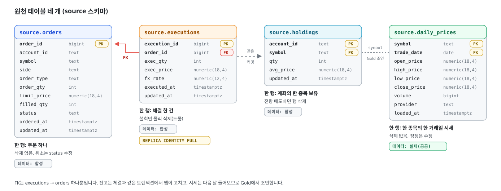
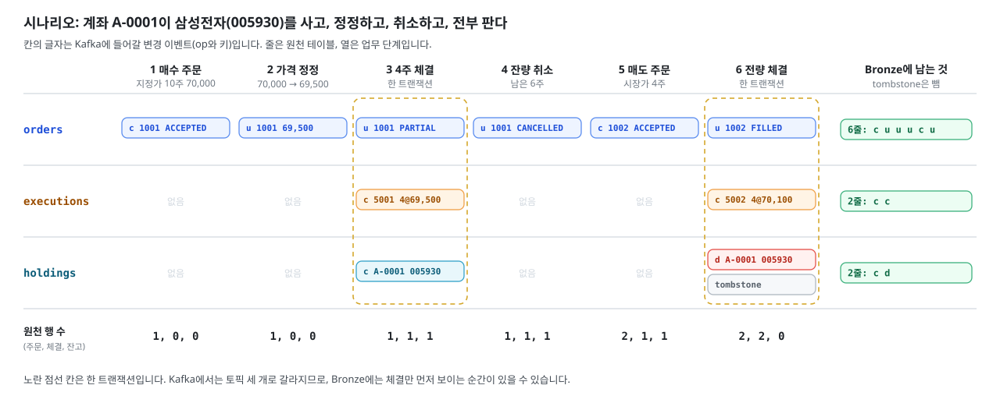

# 원천 테이블

> 3회차 설계, 2026-11-11 확정. DDL은 [`infra/postgres/init/10_brokerage.sql`](../../infra/postgres/init/10_brokerage.sql)입니다.

## 1. 테이블마다 한 행의 의미

| 테이블 | 한 행 | 키 | 시간, 순서 정보 | 이벤트 | 삭제 정책 | 데이터 |
|---|---|---|---|---|---|---|
| `orders` | 고객이 낸 주문 하나 | `order_id` | `ordered_at`, `updated_at` | c, u(정정, 부분 체결, 체결 완료, 취소) | 물리 삭제 없음. 취소는 `status`를 `CANCELLED`로 수정 | 합성 |
| `executions` | 주문 하나에서 일어난 체결 한 건 | `execution_id`, FK `order_id` | `executed_at`, `updated_at` | 주로 c. 드물게 u(정정), d(철회) | 잘못 기록된 체결의 철회만 물리 삭제 | 합성 |
| `holdings` | 계좌 하나가 가진 종목 하나의 현재 보유 | (`account_id`, `symbol`) | `updated_at` | c(첫 매수), u(추가 매수, 일부 매도), d(전량 매도) | 전량 매도하면 행 삭제. 수량 0인 행을 두지 않음 | 합성 |
| `daily_prices` | 한 종목의 한 거래일 시세 | (`symbol`, `trade_date`) | `trade_date`(그 시장 현지 날짜), `loaded_at` | c(매일 적재), u(제공처가 값을 고침) | 삭제 없음 | 실제(공공) |

## 2. 왜 네 개인가

테이블마다 CDC에서 다른 모양을 하나씩 맡고, 네 번째는 실제 데이터가 들어오는 유일한 곳입니다.

| 테이블 | 보여 줄 CDC 모양 | 이어지는 회차 |
|---|---|---|
| `orders` | 한 키가 여러 번 수정됨. 최신 하나를 골라야 함 | 4회차 Silver |
| `executions` | 거의 추가만. 드문 정정과 철회가 지난 날 지표를 바꿈 | 6회차 소급 정정 |
| `holdings` | 현재 상태 테이블이고 물리 삭제가 일상. 키가 두 칸 | 4회차 Silver, 5회차 대사 테스트 |
| `daily_prices` | 앱이 아니라 배치 적재기가 씀. 하루 한 번 몰려 들어오고, 지난 날짜 값이 고쳐지면 u | 5회차 평가금액, 6회차 소급 정정 |

종목 기준 정보(이름, 시장, 통화, 자산군)는 거의 바뀌지 않아 원천 테이블 대신 [`loaders/instruments.csv`](../../loaders/instruments.csv)로 두고, 5회차에 dbt seed로 씁니다. 계좌 테이블은 두지 않고 `account_id` 값만 씁니다.

AI 트랙이 쓰는 원천 테이블(환율, 뉴스, 관심도)은 [`docs/ai/data-prep.md`](../ai/data-prep.md)에 있습니다.

## 3. 관계와 삭제

- FK는 `executions.order_id` → `orders.order_id` 하나뿐입니다. 기본값(`NO ACTION`)이라 주문을 실수로 지우면 오류가 납니다. 주문은 물리 삭제하지 않으므로 체결이 고아가 되지 않습니다.
- 체결이 철회되면 주문은 남고, 앱이 같은 트랜잭션에서 `orders.filled_qty`와 `holdings`를 되돌립니다.
- 시세와 주문 사이에는 FK가 없습니다. 시세는 다음 날 들어와서 오늘 주문이 가리킬 행이 아직 없습니다. 둘은 Gold에서 `symbol`과 날짜로 조인합니다.
- `executions`만 `REPLICA IDENTITY FULL`입니다. 철회(삭제) 이벤트에 `order_id`가 있어야 영향받는 계좌와 종목을 찾을 수 있어서입니다([0005](../decisions/0005-replica-identity-executions-full.md)).

## 4. 자료형

| 칸 | 고른 것 | 이유 |
|---|---|---|
| 가격, 금액 | `numeric(18,4)` | 원과 달러가 같은 칸에 들어옴 |
| 환율 | `numeric(12,4)` | `executions.fx_rate`. 미국 종목 체결 때 적용한 원/달러 환율, 국내는 비움 |
| 커넥터 | `decimal.handling.mode=string` | 기본값에서는 `numeric`이 base64 글자로 나옴 |
| 거래일 | `date` | Debezium은 1970-01-01부터 센 날 수로 내보냄. Silver에서 날짜로 바꿈 |
| 시각 | `timestamptz` | UTC ISO 8601 글자로 나옴 |
| 상태, 방향 | `text`와 `CHECK` | `enum`보다 값을 더하기 쉬움 |
| 통화 | 칸 없음 | 종목이 정하므로 `instruments.csv`에서 붙임 |
| 번호 | `bigint`, 직접 넣음 | 시나리오에서 1001, 5001처럼 정해 넣어야 확인이 쉬움 |

이유와 다른 선택지는 [0004](../decisions/0004-numeric-types-and-decimal-handling.md)에 있습니다.

## 5. 변경 시나리오와 층마다 기대 결과

계좌 `A-0001`이 국내 종목 하나를 사고, 정정하고, 일부 체결 뒤 취소하고, 전부 팝니다. 단계별 SQL은 [`infra/postgres/scenario/`](../../infra/postgres/scenario/README.md)에 있습니다. 가격은 설명용 숫자입니다.

| 단계 | 원천에서 하는 일 |
|---|---|
| 1 | 주문 1001: 매수 지정가 10주 70,000원 |
| 2 | 1001 가격 정정 69,500원 |
| 3 | 한 트랜잭션: 체결 5001(4주), 1001 `PARTIAL`, 잔고 생김 |
| 4 | 1001 남은 6주 취소 |
| 5 | 주문 1002: 매도 시장가 4주 |
| 6 | 한 트랜잭션: 체결 5002(4주, 70,100원), 1002 `FILLED`, 잔고 행 삭제 |

| 테이블 | 원천 행 | Kafka 메시지 | Bronze 행 |
|---|---|---|---|
| `orders` | 2(1001 `CANCELLED`, 1002 `FILLED`) | 6: c, u, u, u, c, u | 6 |
| `executions` | 2 | 2: c, c | 2 |
| `holdings` | 0 | 3: c, d, tombstone | 2: c, d(tombstone은 뺌) |

**확인(2026-11-11, 이 저장소의 기본 profile):** 여섯 단계를 돌린 뒤 원천은 주문 2, 체결 2, 잔고 0행이었고, 토픽 끝 offset은 `orders` 6, `executions` 2, `holdings` 3으로 기대값과 같았습니다. Bronze 행은 4회차에 확인합니다.

**한 트랜잭션이 토픽 셋으로 갈라집니다.** 3단계와 6단계는 세 테이블을 같은 커밋에서 바꾸지만, Kafka에서는 토픽 세 개로 나뉘고 Flink도 토픽마다 따로 읽습니다. 그래서 Bronze에서 잠깐 "체결은 있는데 잔고는 아직"인 순간이 보일 수 있습니다. 같은 커밋인지는 `source.txId`와 `source.lsn`으로 묶어 봅니다.

## 6. 실제와 다르게 줄인 것

- 실제 증권사는 정정, 취소 주문에 새 주문 번호를 붙이고 원주문 번호로 잇습니다. 여기서는 한 행 수정으로 줄였습니다.
- 체결 정정과 철회는 실제로 드뭅니다. 6회차 소급 정정을 보여 주려고 넣은 학습용 사례입니다.
- 수수료, 세금, 예수금, 소수점 거래는 뺐습니다. 수량은 정수 주식만 씁니다.
- 국내 종목 주문은 한국 장중에, 미국 종목 주문은 미국 장중에만 만듭니다. 장 시간 밖 예약 주문은 뺐습니다.

## 7. 수집 방식을 CDC로 고른 이유

| 방식 | 이 도메인에서 생기는 일 |
|---|---|
| 하루 한 번 전체 복사 | 장중 취소율을 못 봅니다. 하루 사이의 정정 경위(정정 전 가격)가 사라집니다 |
| 수정 시각 증분(`updated_at` 이후만) | 전량 매도로 사라진 잔고 행을 못 잡습니다. 두 번 조회 사이의 중간 변경도 사라집니다 |
| 로그 기반 CDC | 삭제와 중간 변경을 모두 받습니다. 대신 replication slot, Kafka, Flink를 운영해야 하고, slot이 밀리면 원천 DB에 WAL이 쌓입니다 |

비교만 하고 재지 않은 대안: Kafka Connect의 Iceberg sink(Flink 없이 Connect가 바로 적재). 실측하지 않았으므로 어느 쪽이 낫다고 적지 않습니다.
